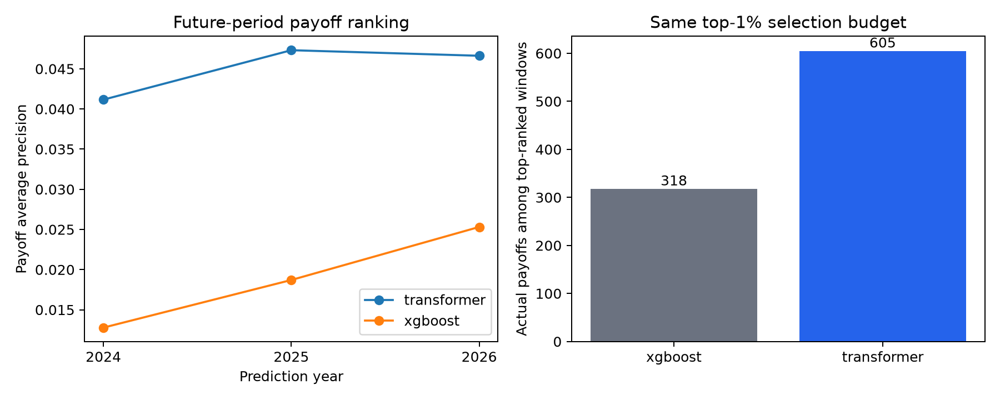

# A focused improvement for the presentation

Analysis prepared from existing saved predictions. This is
exploratory analysis after inspecting the test results, not a new untouched test or
a claim to outperform published mortgage models. No models were refitted.

## Recommended focus: payoff ranking

The transformer has a concrete task-specific advantage over the current XGBoost
baseline: ranking loan-months by the probability of payoff in the next month.
The label includes voluntary payoff and maturity; it does not isolate refinancing,
early prepayment, or default.

In the calendar-held-out experiment, training targets end in 2022, validation is
in 2023, and test targets span 2024 through June 2026, with disjoint loans.

| Measure | XGBoost | Transformer |
|---|---:|---:|
| Payoff average precision | 0.01832 | 0.04490 |
| Actual payoffs among the top 10,093 ranked loan-months | 318 | 605 |
| Precision at that top-1% budget | 3.15% | 5.99% |
| Fraction of all payoffs captured at that budget | 4.69% | 8.93% |

There are 1,009,313 test loan-months and 6,776 payoff events. The budget is a ranking
comparison over pooled loan-months, not 10,093 unique borrowers, a fixed monthly
outreach campaign, or a prospective operating threshold. The sorting cutoff has
no ties in either model. The overall payoff rate is 0.67%.

The transformer also has higher payoff average precision within every future test
year: 0.04116 versus 0.01278 in 2024, 0.04732 versus 0.01871 in 2025, and 0.04663
versus 0.02531 in January–June 2026. In the separate 2018 loan-held-out experiment,
the corresponding pooled scores are 0.07172 versus 0.06273.

A paired bootstrap resampling whole loans, rather than individual months, gives
these 95% percentile intervals for transformer minus XGBoost average precision:

- Future-period test: **[0.02320, 0.03046]**, over 44,592 observed test loans.
- 2018 test: **[0.00611, 0.01221]**, over 6,847 observed test loans.

These use 200 bootstrap replicates and the same fitted models. They capture
test-loan sampling uncertainty, not model-seed variability, tuning uncertainty,
future economic regime uncertainty, or the consequences of selecting this outcome
after inspecting results. Baseline tuning and an independent confirmation remain
necessary before a stronger claim.



Suggested presentation claim:

> In our held-out future-period experiment, the transformer identified about 1.9
> times as many next-month payoffs within the same top-1% selection budget as our
> XGBoost baseline, despite similar or worse overall state-classification scores.

## What the transformer struggles with

**Small delinquency transitions.** On the 2018 test, recall for the 30–59-day class
is 17.9%, versus 22.5% for XGBoost. Ranking new delinquency among currently current
loans yields average precision 0.0952 versus XGBoost's 0.0968. Severe-delinquency
ranking among 30–89-day loans is also slightly weaker than XGBoost. Do not present
these as wins.

**Recovery detection trades off precision.** In the future test, the transformer
detects 62.4% of recovery movements versus 38.6% for XGBoost, but precision is
41.8% versus 53.7%. It predicts recovery much more often. Higher recovery recall
alone would conceal that tradeoff. These movement metrics differ from exact-state
accuracy on recovering loans in the earlier report.

**Rare adverse exits.** The capped 2018 training run has six adverse-exit examples
and its test has six. The future-period run has four in training. A larger
architecture cannot compensate for this lack of training signal. Payoff, with
thousands of examples, is a more credible initial endpoint.

**Calibration after the calendar shift.** In the future test, the observed payoff
rate is 0.67%, while mean predicted probabilities are 2.21% for the transformer
and 2.99% for XGBoost. Their payoff Brier scores are 0.00689 and 0.00771,
respectively; even an always-zero payoff forecast scores 0.00671. The transformer
ranks better, but raw probabilities are overestimated. Ranking superiority does
not establish calibrated probabilities or reliable lifetime cash-flow forecasts.

## Longer context versus architecture changes

History is useful: for new delinquency among currently current loans, moving from
the last-month-only transformer to 12 months raises average precision from 0.0217
to 0.0952 on identical eligible test examples. This is a strong history ablation,
but XGBoost with the same history still scores 0.0968. It does not show that 24 or
36 months will help.

A controlled 12-versus-24-month comparison is worthwhile, especially for repeated
delinquency episodes. Restrict both models to the same loans and target months
with sufficient 24-month history, give XGBoost the same context, and refit
preprocessing on training inputs. Merely increasing the window changes which loans
survive eligibility, potentially making apparent improvements misleading.

The most targeted architecture hypothesis is **static-conditioned attention**.
The current encoder processes monthly measurements without seeing origination
FICO, LTV, purpose, or occupancy; those attributes enter only the final classifier.
A small projected static-context token would let attention interpret history in
the context of the loan profile. Compare this single change to the current model
with matched data, tuning budgets, and seeds. This mechanism is inspired by the
static-conditioning approach in [Temporal Fusion Transformers](https://arxiv.org/abs/1912.09363),
not a claim that a full TFT implementation or more layers will necessarily help.

Before enlarging the architecture, test validation-only calibration and improve
the information available about payoff incentives. The current inputs include the
loan rate but not prevailing mortgage rates or the rate differential. Existing
[mortgage-risk research](https://academic.oup.com/jfec/article/19/2/313/6329869)
identifies rate differences and macroeconomic variables as relevant predictors.
Any added features must be available by the prediction date and supplied to
XGBoost as well. Recursive forecasts would need explicit future-rate assumptions
or scenarios if those variables are introduced into the generator.

## Recommended experiment order

1. Make next-month payoff ranking the primary focused endpoint, while retaining
   the full state and delinquency results as secondary outcomes. Explicitly record
   that this focus was chosen after exploratory testing.
2. Repeat the matched baseline and transformer fits over several model seeds;
   use validation data for hyperparameters and probability calibration.
3. Test the static-context-token change as a single architecture ablation.
4. Compare 12 and 24 months on a common eligible population and equal information.
5. Confirm the selected approach on newly reserved data under a documented
   protocol. Existing inspected test sets should be treated as development evidence.

The project can already present the measured ranking advantage. Additional
architectural changes are hypotheses, not guaranteed improvements.

### Follow-up result

The static-context-token hypothesis was subsequently implemented and tested in
three paired CPU seeds. It improved payoff AP in one seed and reduced it in two;
the mean change was -0.00395. A separate matched GPU repeat also reduced payoff
AP. See [the complete results](static-conditioning/RESULTS.md). This supports
keeping the original transformer as the current reference, rather than presenting
static conditioning as an established improvement. CUDA training on the RTX 5070
is now available for larger-data or longer-context follow-ups.

The [longer-context follow-up](context-length/RESULTS.md) is also complete. On a
matched 24-month-eligible population, ordinary transformer mean payoff AP is
0.04160 with 12 months and 0.04206 with 24; the seed effect is mixed. The conditioned
variant gets worse with 24 months in all three tested seeds. This does not provide
a reliable gain from extending context. XGBoost receives the same longer history,
and persistence remains identical because it uses only the most recent state.

## Reproduction

```bash
MPLCONFIGDIR=/tmp/mortgage-matplotlib .venv/bin/python analysis/diagnose_errors.py
```

The script writes aggregate ranking, transition, history-ablation, calibration,
bootstrap, and figure artifacts under `reports/diagnostics/`. Its weighted AP
calculation checks tie and zero-weight handling against scikit-learn. No per-loan
identifiers or predictions are copied into this report directory.
