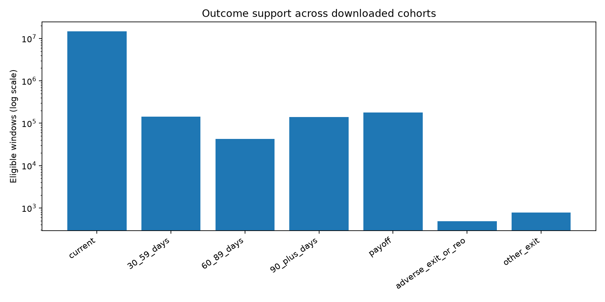
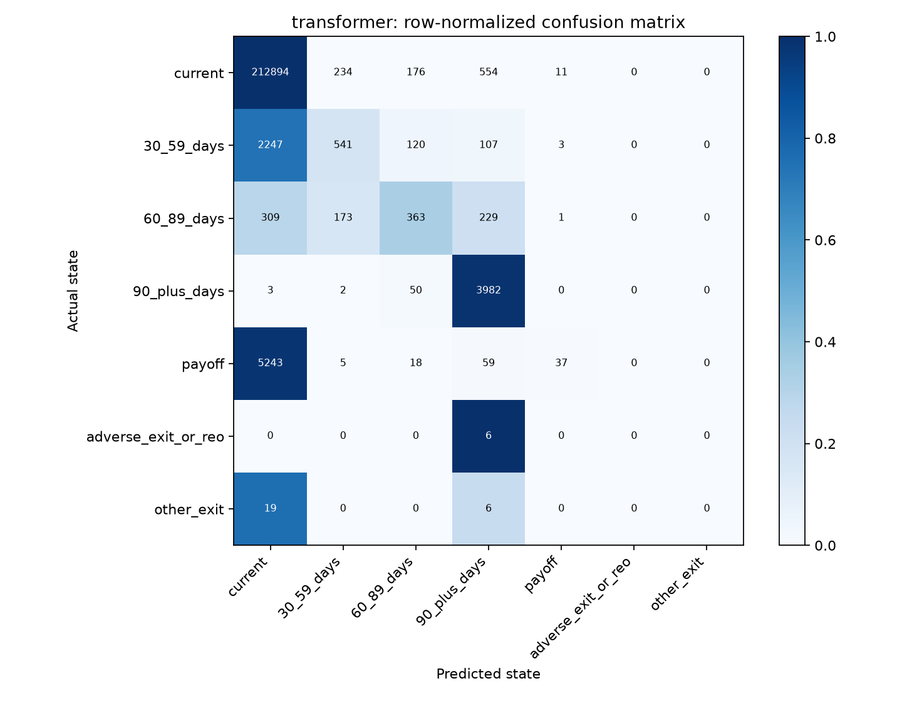
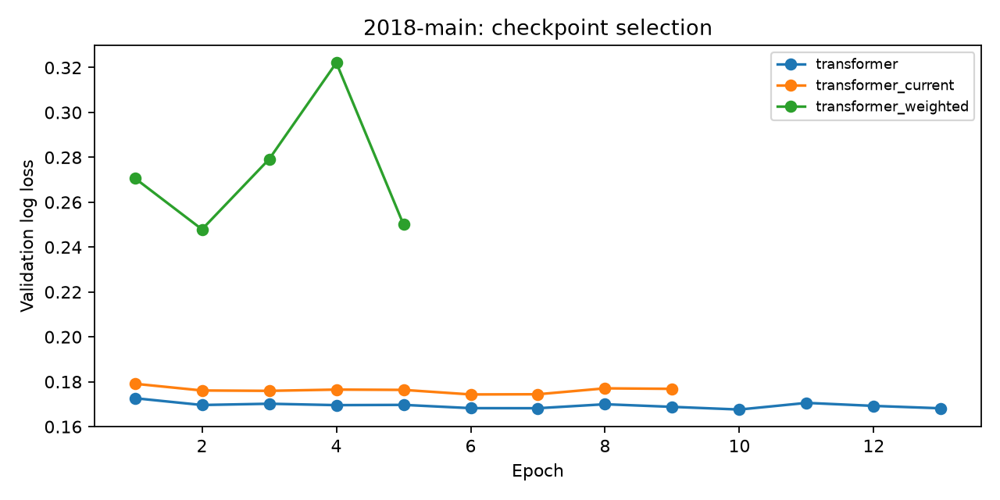
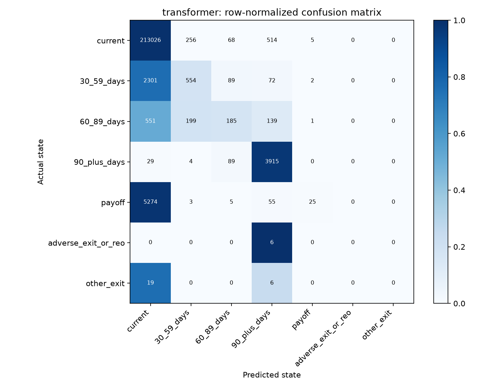
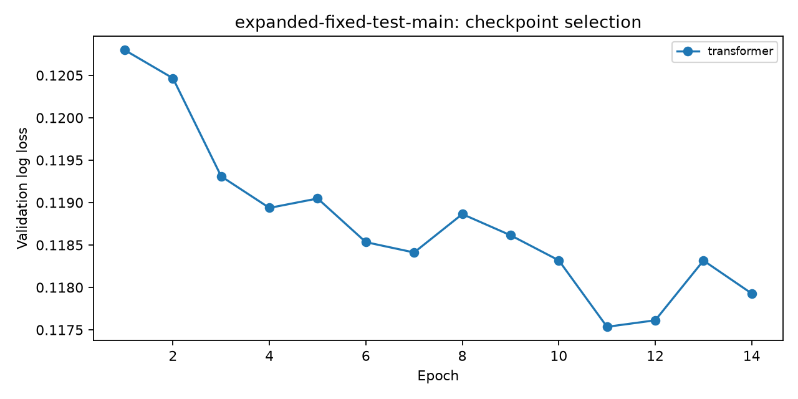
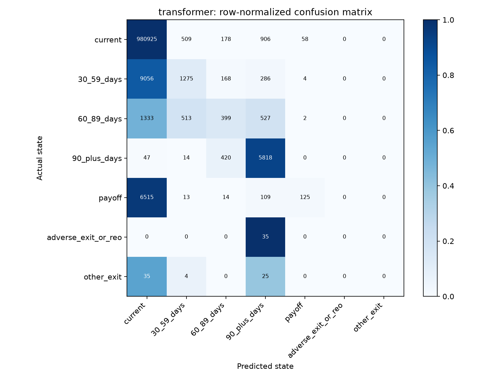
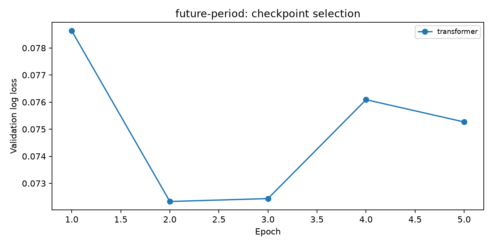
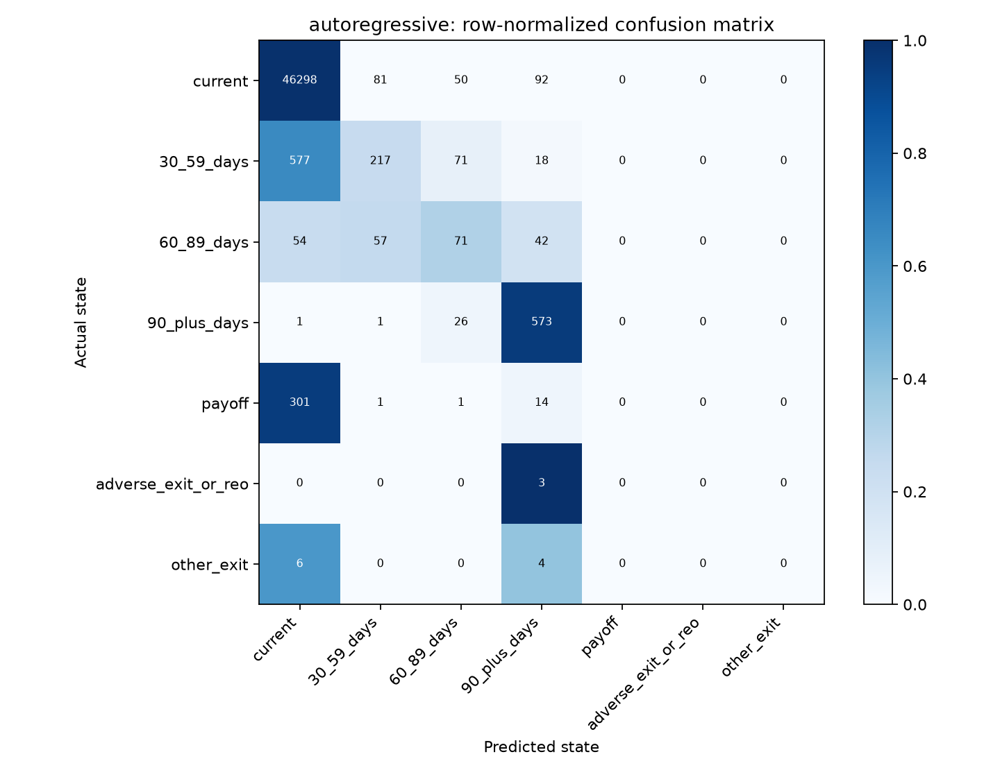
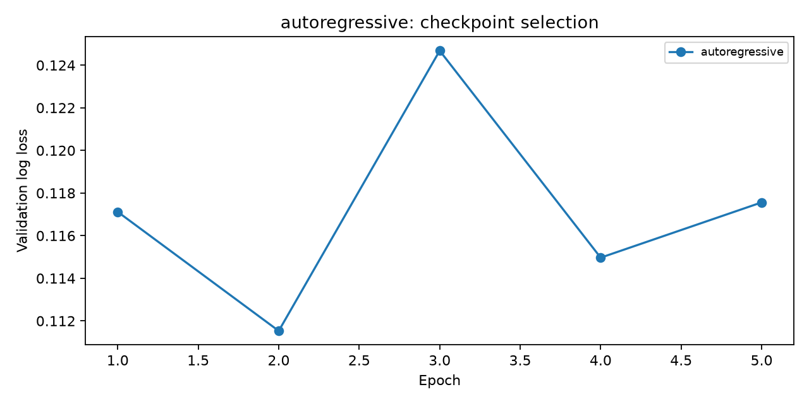
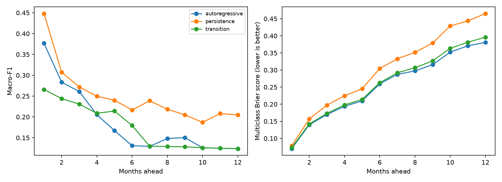

# Mortgage outcome experiment report

Prepared from local data-quality summaries and completed experiment artifacts.
The project authors should review this draft and verify the related-work references before submission.

## Research question

Does a small transformer using 12 months of history improve next-month loan-state predictions over persistence and XGBoost?

## Data inventory

| Origination year | Loans | Raw monthly rows | Eligible windows | Reporting coverage | ZIP MB | Extracted MB |
|---|---:|---:|---:|---|---:|---:|
| 2016 | 50,000 | 3,421,458 | 2,830,970 | 2016-01 to 2026-06 | 55.6 | 391.1 |
| 2017 | 50,000 | 2,837,053 | 2,247,591 | 2017-01 to 2026-06 | 46.6 | 328.8 |
| 2018 | 50,000 | 2,089,132 | 1,505,402 | 2018-01 to 2026-06 | 34.4 | 244.1 |
| 2019 | 50,000 | 1,977,122 | 1,403,851 | 2019-01 to 2026-06 | 33.1 | 233.1 |
| 2020 | 50,000 | 2,611,030 | 2,032,837 | 2020-01 to 2026-06 | 43.6 | 302.7 |
| 2021 | 50,000 | 2,657,066 | 2,067,442 | 2021-01 to 2026-06 | 43.9 | 312.9 |
| 2022 | 50,000 | 2,151,863 | 1,560,854 | 2022-01 to 2026-06 | 34.7 | 255.6 |
| 2023 | 50,000 | 1,567,055 | 980,174 | 2023-01 to 2026-06 | 24.7 | 189.1 |
| 2024 | 50,000 | 1,074,005 | 489,594 | 2024-01 to 2026-06 | 16.8 | 131.2 |
| 2025 | 50,000 | 541,883 | 51,675 | 2025-01 to 2026-06 | 8.4 | 69.4 |

Total: 500,000 loans and 20,927,667 raw monthly records. Cohort samples have equal loan counts, not equal monthly record counts.

Preparation removed 1,927 rows after first exit/REO and excluded 12 windows spanning reporting gaps. Other exclusions and missingness are recorded per cohort in the quality manifests.

The downloaded release label and exact download date are unconfirmed. File SHA-256 checksums and the observed column layout identify the local inputs.

| Outcome | Eligible windows | Fraction |
|---|---:|---:|
| current | 14,662,206 | 96.650159% |
| 30_59_days | 143,214 | 0.944036% |
| 60_89_days | 42,650 | 0.281140% |
| 90_plus_days | 141,090 | 0.930035% |
| payoff | 179,965 | 1.186291% |
| adverse_exit_or_reo | 487 | 0.003210% |
| other_exit | 778 | 0.005128% |

## Methods

Loans are assigned reproducibly to approximately 70%/15%/15% training/validation/test partitions. All models in an experiment use the same examples. Numeric preprocessing and categorical vocabularies are fitted only on training inputs. Windows require 12 consecutive active observations and an observed next-month target; histories stop at the first exit/REO event. See [methodology](../docs/methodology.md) for exact label mappings and feature rules.

Transformer: two encoder layers, four attention heads, hidden size 64 by default, with origination features joined at the classifier. Early stopping minimizes natural-distribution validation log loss. The one-month ablation retains the same target population. Class weighting uses training counts only.

Macro-F1 below always uses the fixed seven classes. Persistence has no probabilistic log loss. Counts, rare-class precision/recall, supported-class macro-F1, transition errors, and group metrics are available in each run's local artifacts.

## Completed experiments

### 2018-main

Cohorts: 2018; model seed 522; 200,000 training, 226,527 validation, and 227,392 test windows. Runtime 11.7 minutes; peak process RSS 1.38 GiB. Loan-held-out evaluation across available reporting years; this is not a future-only test.

| Model | Validation log loss | Test macro-F1 | Test accuracy | Test log loss |
|---|---:|---:|---:|---:|
| persistence | — | 0.3476 | 0.9542 | — |
| transition | 0.18498 | 0.2658 | 0.9558 | 0.18709 |
| xgboost | 0.16762 | 0.3664 | 0.9578 | 0.16969 |
| transformer | 0.16762 | 0.3651 | 0.9579 | 0.16914 |
| transformer_weighted | 0.24790 | 0.3669 | 0.9484 | 0.25028 |
| transformer_current | 0.17434 | 0.3622 | 0.9562 | 0.17606 |

Rare-event support: adverse_exit_or_reo: train=6, validation=10, test=6; other_exit: train=18, validation=13, test=25.

Lowest validation log loss selects **transformer** among this run's probabilistic candidates.

| Outcome | Test support | Precision | Recall | F1 |
|---|---:|---:|---:|---:|
| current | 213,869 | 0.9646 | 0.9954 | 0.9798 |
| 30_59_days | 3,018 | 0.5665 | 0.1793 | 0.2723 |
| 60_89_days | 1,075 | 0.4993 | 0.3377 | 0.4029 |
| 90_plus_days | 4,037 | 0.8056 | 0.9864 | 0.8869 |
| payoff | 5,362 | 0.7115 | 0.0069 | 0.0137 |
| adverse_exit_or_reo | 6 | 0.0000 | 0.0000 | 0.0000 |
| other_exit | 25 | 0.0000 | 0.0000 | 0.0000 |

| Actual transition | Test examples | Selected model accuracy |
|---|---:|---:|
| unchanged | 216,967 | 0.9966 |
| worsening | 3,157 | 0.2556 |
| recovery | 1,875 | 0.3947 |
| terminal | 5,393 | 0.0069 |

### expanded-fixed-test-main

Cohorts: 2016, 2017, 2018, 2019, 2020; model seed 522; 200,000 training, 100,000 validation, and 227,392 test windows. Runtime 8.4 minutes; peak process RSS 3.08 GiB. Loan-held-out evaluation across available reporting years; this is not a future-only test. Test cohorts restricted to [2018].

| Model | Validation log loss | Test macro-F1 | Test accuracy | Test log loss |
|---|---:|---:|---:|---:|
| persistence | — | 0.3476 | 0.9542 | — |
| transition | 0.12866 | 0.2658 | 0.9558 | 0.19025 |
| xgboost | 0.11833 | 0.3557 | 0.9575 | 0.17230 |
| transformer | 0.11754 | 0.3434 | 0.9574 | 0.17105 |

Rare-event support: adverse_exit_or_reo: train=3, validation=3, test=6; other_exit: train=14, validation=5, test=25.

Lowest validation log loss selects **transformer** among this run's probabilistic candidates.

| Outcome | Test support | Precision | Recall | F1 |
|---|---:|---:|---:|---:|
| current | 213,869 | 0.9630 | 0.9961 | 0.9793 |
| 30_59_days | 3,018 | 0.5453 | 0.1836 | 0.2747 |
| 60_89_days | 1,075 | 0.4243 | 0.1721 | 0.2449 |
| 90_plus_days | 4,037 | 0.8317 | 0.9698 | 0.8955 |
| payoff | 5,362 | 0.7576 | 0.0047 | 0.0093 |
| adverse_exit_or_reo | 6 | 0.0000 | 0.0000 | 0.0000 |
| other_exit | 25 | 0.0000 | 0.0000 | 0.0000 |

| Actual transition | Test examples | Selected model accuracy |
|---|---:|---:|
| unchanged | 216,967 | 0.9970 |
| worsening | 3,157 | 0.1562 |
| recovery | 1,875 | 0.4624 |
| terminal | 5,393 | 0.0046 |

### future-period

Cohorts: 2016, 2017, 2018, 2019, 2020, 2021, 2022, 2023, 2024, 2025; model seed 522; 200,000 training, 100,000 validation, and 1,009,313 test windows. Runtime 3.7 minutes; peak process RSS 4.47 GiB. Training targets through 2022-12; validation through 2023-12; test targets thereafter.

| Model | Validation log loss | Test macro-F1 | Test accuracy | Test log loss |
|---|---:|---:|---:|---:|
| persistence | — | 0.3678 | 0.9792 | — |
| transition | 0.08280 | 0.2587 | 0.9786 | 0.09928 |
| xgboost | 0.07344 | 0.3536 | 0.9803 | 0.10138 |
| transformer | 0.07233 | 0.3219 | 0.9794 | 0.09550 |

Rare-event support: adverse_exit_or_reo: train=4, validation=0, test=35; other_exit: train=14, validation=4, test=64.

Lowest validation log loss selects **transformer** among this run's probabilistic candidates.

| Outcome | Test support | Precision | Recall | F1 |
|---|---:|---:|---:|---:|
| current | 982,576 | 0.9830 | 0.9983 | 0.9906 |
| 30_59_days | 10,789 | 0.5477 | 0.1182 | 0.1944 |
| 60_89_days | 2,774 | 0.3384 | 0.1438 | 0.2019 |
| 90_plus_days | 6,299 | 0.7550 | 0.9236 | 0.8308 |
| payoff | 6,776 | 0.6614 | 0.0184 | 0.0359 |
| adverse_exit_or_reo | 35 | 0.0000 | 0.0000 | 0.0000 |
| other_exit | 64 | 0.0000 | 0.0000 | 0.0000 |

| Actual transition | Test examples | Selected model accuracy |
|---|---:|---:|
| unchanged | 988,287 | 0.9959 |
| worsening | 8,423 | 0.0709 |
| recovery | 5,728 | 0.6217 |
| terminal | 6,875 | 0.0182 |

### autoregressive

Cohorts: 2018; model seed 522; 200,000 training, 22,318 validation, and 48,559 test windows. Runtime 1.9 minutes; peak process RSS 1.05 GiB. Training targets through 2022-12; validation through 2023-12; test targets thereafter.

| Model | Validation log loss | Test macro-F1 | Test accuracy | Test log loss |
|---|---:|---:|---:|---:|
| persistence | — | 0.3669 | 0.9695 | — |
| transition | 0.13196 | 0.2597 | 0.9682 | 0.14013 |
| autoregressive | 0.11153 | 0.3584 | 0.9712 | 0.11845 |

Rare-event support: adverse_exit_or_reo: train=5, validation=2, test=3; other_exit: train=9, validation=1, test=10.

Lowest validation log loss selects **autoregressive** among this run's probabilistic candidates.

| Outcome | Test support | Precision | Recall | F1 |
|---|---:|---:|---:|---:|
| current | 46,521 | 0.9801 | 0.9952 | 0.9876 |
| 30_59_days | 883 | 0.6078 | 0.2458 | 0.3500 |
| 60_89_days | 224 | 0.3242 | 0.3170 | 0.3205 |
| 90_plus_days | 601 | 0.7681 | 0.9534 | 0.8508 |
| payoff | 317 | 0.0000 | 0.0000 | 0.0000 |
| adverse_exit_or_reo | 3 | 0.0000 | 0.0000 | 0.0000 |
| other_exit | 10 | 0.0000 | 0.0000 | 0.0000 |

| Actual transition | Test examples | Selected model accuracy |
|---|---:|---:|
| unchanged | 47,078 | 0.9950 |
| worsening | 672 | 0.1607 |
| recovery | 479 | 0.4342 |
| terminal | 330 | 0.0000 |

#### Recursive forecasts

State-only histories and fixed origination attributes allow recursive generation without assuming future balances or rates. Each generated state is fed back; paths stop at the first terminal event. The backtest uses one random origin per uniformly selected held-out loan and 128 sampled paths per origin in this run.

| Months ahead | Model | Observed outcomes | Macro-F1 | Brier score |
|---|---|---:|---:|---:|
| 1 | autoregressive | 1,000 | 0.3769 | 0.07005 |
| 1 | transition | 1,000 | 0.2659 | 0.07295 |
| 1 | persistence | 1,000 | 0.4481 | 0.07800 |
| 3 | autoregressive | 943 | 0.2610 | 0.16989 |
| 3 | transition | 943 | 0.2308 | 0.17312 |
| 3 | persistence | 943 | 0.2719 | 0.19724 |
| 6 | autoregressive | 880 | 0.1309 | 0.25968 |
| 6 | transition | 880 | 0.1794 | 0.26302 |
| 6 | persistence | 880 | 0.2167 | 0.30455 |
| 12 | autoregressive | 705 | 0.1239 | 0.38094 |
| 12 | transition | 705 | 0.1239 | 0.39612 |
| 12 | persistence | 705 | 0.2049 | 0.46525 |

Brier score measures probability error; lower is better. Monte Carlo log loss is omitted because finite trajectory samples produce zero-probability estimates. Known exits are absorbing for probability accounting; unobserved/censored outcomes are excluded separately at each horizon. Changing outcome support means differences across horizons are not solely measures of accumulated model error.

## Interpretation and limitations

Compare expansion runs only when the test cohorts, eligible windows, file fingerprints, date boundaries, and test sampling are identical. A fixed training-window cap measures expansion under a fixed compute/data budget, rather than training on every available example. Validation populations may differ between single-year and expanded runs; they are used only to choose each run's checkpoint.

High accuracy can follow from mostly unchanged current loans. Focus on macro-F1, class support, worsening/recovery transitions, and rare-event recall. Adverse-exit counts may be too small for reliable conclusions. Do not interpret seven classes as seven ordered delinquency levels or claim to predict all stages of foreclosure.

The fixed-history requirement excludes early outcomes and short histories. Long loans contribute more correlated windows. Equal cohort samples do not reproduce origination-volume weights. Historical snapshots include reporting revisions and do not guarantee real-time availability of all fields. Calendar-held-out results answer a different question from random loan-held-out results. Multiple optimization seeds are not independent samples of the underlying loan population.

Recursive state forecasting is implemented and evaluated separately from the full-feature one-month predictor. It omits evolving balances, interest rates, and economic conditions; its simulated paths should not be interpreted as calibrated long-term mortgage default probabilities. Longer histories and directly supervised fixed-horizon prediction remain optional. Crisis cohorts were not supplied. Related-work titles, authors, and narrow summaries were checked against primary sources, but full-paper reading and author review remain necessary before academic submission.

## Reproduction

See [README](../README.md) for setup, preparation, training, future-period evaluation, and tests. Each local run saves its exact command options in config.json, library versions, source fingerprints, selected examples, loan assignments, preprocessing, fitted models, predictions, metrics, and resources. Licensed data and per-loan artifacts remain excluded from version control.
