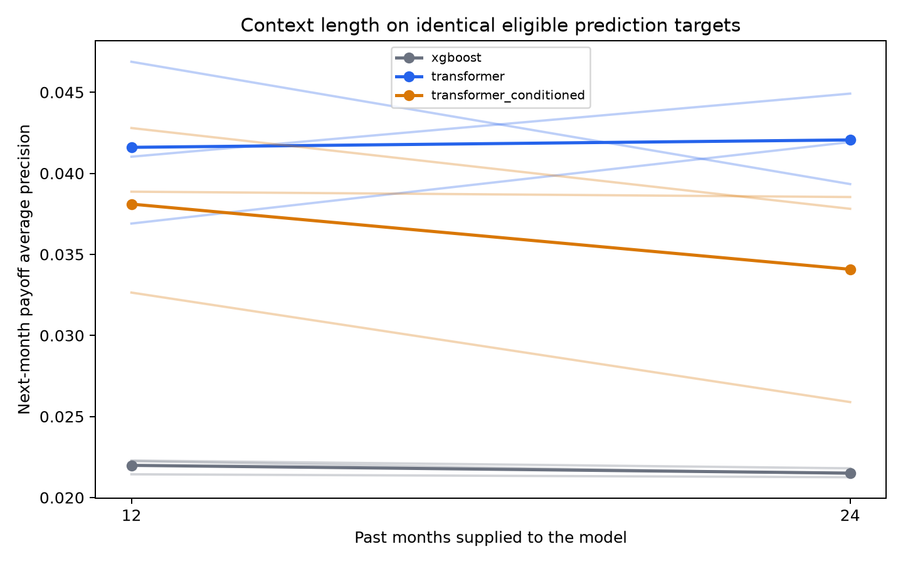

# More past context: 12 versus 24 months

See the [predeclared protocol](PROTOCOL.md). This is an exploratory comparison on inspected test data.

## What changes for each model?

The target remains the next reporting month's state. The transformer attends to either 12 or 24 monthly tokens. XGBoost receives the same monthly vectors flattened into features, plus origination attributes: 116 input columns at 12 months and 212 at 24 months. Both must be retrained. Persistence copies the last observed state and does not use the older history; its predictions are identical on the matched examples.

## Controls

All six runs use the same 809,831 test loan-months, 200,000 sampled training targets, and 100,000 sampled validation targets. Every example has 24 consecutive active input months and an observed next-month target, even for the 12-month arm. All prediction identities and population fingerprints match. Static preprocessing and categorical vocabularies match; dynamic scaling is fitted separately on each context's training inputs.

Training targets end in 2022; validation is in 2023; test targets follow. Seeds 522, 523, and 524 are paired across contexts. XGBoost and both transformers train with CUDA on the RTX 5070. Persistence is a direct vectorized last-state rule. Checkpoint selection and all other model/training settings follow the protocol. Cached prepared files were reused; window indices were recalculated without modifying raw files.

The common-history restriction changes the population from the earlier broad 12-month experiments. It excludes early exits and newer/short-history loans. These scores should be compared within this experiment, not directly against the earlier test population.

## Mean scores over three seeds

| Model | Context | Payoff AP | New delinquency AP | Macro-F1 | Payoff Brier | Precision at top 1% |
|---|---:|---:|---:|---:|---:|---:|
| persistence | 12 | 0.00588 | 0.00559 | 0.3706 | 0.005883 | — |
| xgboost | 12 | 0.02198 | 0.12263 | 0.3491 | 0.006306 | 3.96% |
| transformer | 12 | 0.04160 | 0.11182 | 0.3399 | 0.006003 | 4.61% |
| transformer_conditioned | 12 | 0.03810 | 0.10292 | 0.3326 | 0.005935 | 4.34% |
| persistence | 24 | 0.00588 | 0.00559 | 0.3706 | 0.005883 | — |
| xgboost | 24 | 0.02151 | 0.12627 | 0.3498 | 0.006287 | 3.56% |
| transformer | 24 | 0.04206 | 0.11644 | 0.3371 | 0.005995 | 4.77% |
| transformer_conditioned | 24 | 0.03408 | 0.11424 | 0.3372 | 0.005995 | 3.81% |

AP and macro-F1: higher is better. Brier: lower is better. New-delinquency AP is measured among currently current loans; persistence gives all these loans the same zero delinquency-risk score, so its AP equals event prevalence. Persistence also assigns zero payoff probability to every loan: it cannot prioritize payoffs, and a top-one-percent payoff selection would be arbitrary because all scores tie.

## Paired payoff-ranking effect

| Model | Seed 522 AP change | Seed 523 AP change | Seed 524 AP change | Mean change | Positive seeds |
|---|---:|---:|---:|---:|---:|
| persistence | +0.00000 | +0.00000 | +0.00000 | +0.00000 | 0/3 |
| xgboost | -0.00048 | -0.00018 | -0.00077 | -0.00048 | 0/3 |
| transformer | +0.00503 | -0.00755 | +0.00389 | +0.00046 | 2/3 |
| transformer_conditioned | -0.00675 | -0.00498 | -0.00033 | -0.00402 | 0/3 |

The ordinary transformer's payoff AP improves in **2 of 3 seeds**, with mean change **+0.00046**.

The longer-context effect varies by seed. This does not establish a reliable transformer improvement, even if the mean change is positive.

Persistence's predictions and metrics match exactly across context lengths. Changes in persistence scores on other experiments would reflect different evaluated loans/months or forecast horizons, not learning from additional past observations.

Full per-seed metrics, yearly payoff ranking, paired differences, and effective window selection are saved alongside this report. Three seeds describe limited optimization variability; they do not establish a precise population confidence interval or independent confirmation. Longer learned positional embeddings add parameters and alter seeded initialization. Rare default-like exits remain poorly supported.



## Reproduction

```bash
MPLCONFIGDIR=/tmp/mortgage-matplotlib .venv-gpu/bin/python analysis/run_context_experiment.py
MPLCONFIGDIR=/tmp/mortgage-matplotlib .venv-gpu/bin/python analysis/compare_context_lengths.py
```

The driver skips only completed runs whose configurations match its protocol. Existing incomplete run directories are not overwritten. GPU access is required outside the agent sandbox; XGBoost uses `device=cuda` with `tree_method=hist`.
