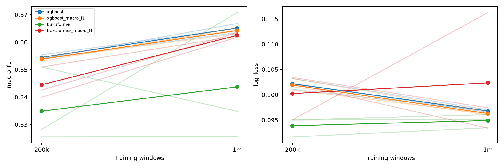

# Training-data size: 200,000 versus 1 million windows

See the [recorded protocol](PROTOCOL.md).

All comparisons use nested training subsets, identical 100,000-example validation and 1,009,313-example test populations, 12-month context, and three paired initialization seeds. Both model families trained on the RTX 5070. Each transformer fit used 6,000 full-minibatch updates (3,072,000 example exposures); each XGBoost fit used 200 rounds. Preprocessing was fitted on each training subset separately.

Each training run produces two checkpoint variants, selected solely by validation log loss or macro-F1. The names without `_macro_f1` use log-loss selection. Both variants are reported; they share one fit. Persistence is unchanged across all runs.

| Model / checkpoint | Training windows | Macro-F1 ↑ | Log loss ↓ | Accuracy ↑ |
|---|---:|---:|---:|---:|
| persistence | 200,000 | 0.3678 | — | 0.97917 |
| xgboost | 200,000 | 0.3545 | 0.10218 | 0.98034 |
| xgboost_macro_f1 | 200,000 | 0.3538 | 0.10192 | 0.98037 |
| transformer | 200,000 | 0.3349 | 0.09387 | 0.97979 |
| transformer_macro_f1 | 200,000 | 0.3445 | 0.10022 | 0.98003 |
| persistence | 1,000,000 | 0.3678 | — | 0.97917 |
| xgboost | 1,000,000 | 0.3651 | 0.09678 | 0.98046 |
| xgboost_macro_f1 | 1,000,000 | 0.3642 | 0.09629 | 0.98050 |
| transformer | 1,000,000 | 0.3437 | 0.09490 | 0.97993 |
| transformer_macro_f1 | 1,000,000 | 0.3625 | 0.10235 | 0.98006 |

Macro-F1 averages all seven predefined classes. Persistence produces hard predictions; its log loss is undefined. Accuracy is dominated by current loans.

## Paired larger-minus-smaller changes

| Model / checkpoint | Macro-F1 mean change | F1 improves in seeds | Log-loss mean change | Loss improves in seeds |
|---|---:|---:|---:|---:|
| xgboost | +0.01064 | 3/3 | -0.00539 | 3/3 |
| xgboost_macro_f1 | +0.01041 | 3/3 | -0.00563 | 3/3 |
| transformer | +0.00884 | 2/3 | +0.00103 | 0/3 |
| transformer_macro_f1 | +0.01799 | 3/3 | +0.00213 | 2/3 |

## Per-class mean scores

| Model / checkpoint | Windows | Class | Precision | Recall | F1 | Test support |
|---|---:|---|---:|---:|---:|---:|
| persistence | 200,000 | current | 0.9877 | 0.9948 | 0.9912 | 982,576 |
| persistence | 200,000 | 30_59_days | 0.4460 | 0.4449 | 0.4454 | 10,789 |
| persistence | 200,000 | 60_89_days | 0.3022 | 0.3025 | 0.3023 | 2,774 |
| persistence | 200,000 | 90_plus_days | 0.8427 | 0.8290 | 0.8358 | 6,299 |
| persistence | 200,000 | payoff | 0.0000 | 0.0000 | 0.0000 | 6,776 |
| persistence | 200,000 | adverse_exit_or_reo | 0.0000 | 0.0000 | 0.0000 | 35 |
| persistence | 200,000 | other_exit | 0.0000 | 0.0000 | 0.0000 | 64 |
| xgboost | 200,000 | current | 0.9859 | 0.9969 | 0.9914 | 982,576 |
| xgboost | 200,000 | 30_59_days | 0.5859 | 0.3011 | 0.3978 | 10,789 |
| xgboost | 200,000 | 60_89_days | 0.3015 | 0.2151 | 0.2508 | 2,774 |
| xgboost | 200,000 | 90_plus_days | 0.7418 | 0.9633 | 0.8382 | 6,299 |
| xgboost | 200,000 | payoff | 0.3704 | 0.0016 | 0.0032 | 6,776 |
| xgboost | 200,000 | adverse_exit_or_reo | 0.0000 | 0.0000 | 0.0000 | 35 |
| xgboost | 200,000 | other_exit | 0.0000 | 0.0000 | 0.0000 | 64 |
| xgboost_macro_f1 | 200,000 | current | 0.9859 | 0.9969 | 0.9914 | 982,576 |
| xgboost_macro_f1 | 200,000 | 30_59_days | 0.5869 | 0.3019 | 0.3986 | 10,789 |
| xgboost_macro_f1 | 200,000 | 60_89_days | 0.3040 | 0.2081 | 0.2466 | 2,774 |
| xgboost_macro_f1 | 200,000 | 90_plus_days | 0.7401 | 0.9649 | 0.8377 | 6,299 |
| xgboost_macro_f1 | 200,000 | payoff | 0.3564 | 0.0013 | 0.0025 | 6,776 |
| xgboost_macro_f1 | 200,000 | adverse_exit_or_reo | 0.0000 | 0.0000 | 0.0000 | 35 |
| xgboost_macro_f1 | 200,000 | other_exit | 0.0000 | 0.0000 | 0.0000 | 64 |
| transformer | 200,000 | current | 0.9845 | 0.9975 | 0.9910 | 982,576 |
| transformer | 200,000 | 30_59_days | 0.5562 | 0.2148 | 0.2979 | 10,789 |
| transformer | 200,000 | 60_89_days | 0.2929 | 0.1525 | 0.2004 | 2,774 |
| transformer | 200,000 | 90_plus_days | 0.7464 | 0.9505 | 0.8355 | 6,299 |
| transformer | 200,000 | payoff | 0.7487 | 0.0099 | 0.0193 | 6,776 |
| transformer | 200,000 | adverse_exit_or_reo | 0.0000 | 0.0000 | 0.0000 | 35 |
| transformer | 200,000 | other_exit | 0.0000 | 0.0000 | 0.0000 | 64 |
| transformer_macro_f1 | 200,000 | current | 0.9850 | 0.9974 | 0.9911 | 982,576 |
| transformer_macro_f1 | 200,000 | 30_59_days | 0.5589 | 0.2551 | 0.3474 | 10,789 |
| transformer_macro_f1 | 200,000 | 60_89_days | 0.2942 | 0.1752 | 0.2189 | 2,774 |
| transformer_macro_f1 | 200,000 | 90_plus_days | 0.7635 | 0.9356 | 0.8403 | 6,299 |
| transformer_macro_f1 | 200,000 | payoff | 0.7844 | 0.0069 | 0.0136 | 6,776 |
| transformer_macro_f1 | 200,000 | adverse_exit_or_reo | 0.0000 | 0.0000 | 0.0000 | 35 |
| transformer_macro_f1 | 200,000 | other_exit | 0.0000 | 0.0000 | 0.0000 | 64 |
| persistence | 1,000,000 | current | 0.9877 | 0.9948 | 0.9912 | 982,576 |
| persistence | 1,000,000 | 30_59_days | 0.4460 | 0.4449 | 0.4454 | 10,789 |
| persistence | 1,000,000 | 60_89_days | 0.3022 | 0.3025 | 0.3023 | 2,774 |
| persistence | 1,000,000 | 90_plus_days | 0.8427 | 0.8290 | 0.8358 | 6,299 |
| persistence | 1,000,000 | payoff | 0.0000 | 0.0000 | 0.0000 | 6,776 |
| persistence | 1,000,000 | adverse_exit_or_reo | 0.0000 | 0.0000 | 0.0000 | 35 |
| persistence | 1,000,000 | other_exit | 0.0000 | 0.0000 | 0.0000 | 64 |
| xgboost | 1,000,000 | current | 0.9861 | 0.9968 | 0.9914 | 982,576 |
| xgboost | 1,000,000 | 30_59_days | 0.5948 | 0.3037 | 0.4021 | 10,789 |
| xgboost | 1,000,000 | 60_89_days | 0.3290 | 0.3089 | 0.3182 | 2,774 |
| xgboost | 1,000,000 | 90_plus_days | 0.7572 | 0.9472 | 0.8416 | 6,299 |
| xgboost | 1,000,000 | payoff | 0.5907 | 0.0012 | 0.0025 | 6,776 |
| xgboost | 1,000,000 | adverse_exit_or_reo | 0.0000 | 0.0000 | 0.0000 | 35 |
| xgboost | 1,000,000 | other_exit | 0.0000 | 0.0000 | 0.0000 | 64 |
| xgboost_macro_f1 | 1,000,000 | current | 0.9860 | 0.9970 | 0.9914 | 982,576 |
| xgboost_macro_f1 | 1,000,000 | 30_59_days | 0.5977 | 0.3002 | 0.3996 | 10,789 |
| xgboost_macro_f1 | 1,000,000 | 60_89_days | 0.3353 | 0.2992 | 0.3159 | 2,774 |
| xgboost_macro_f1 | 1,000,000 | 90_plus_days | 0.7556 | 0.9489 | 0.8413 | 6,299 |
| xgboost_macro_f1 | 1,000,000 | payoff | 0.6972 | 0.0007 | 0.0015 | 6,776 |
| xgboost_macro_f1 | 1,000,000 | adverse_exit_or_reo | 0.0000 | 0.0000 | 0.0000 | 35 |
| xgboost_macro_f1 | 1,000,000 | other_exit | 0.0000 | 0.0000 | 0.0000 | 64 |
| transformer | 1,000,000 | current | 0.9845 | 0.9975 | 0.9910 | 982,576 |
| transformer | 1,000,000 | 30_59_days | 0.6130 | 0.2171 | 0.2986 | 10,789 |
| transformer | 1,000,000 | 60_89_days | 0.3319 | 0.2192 | 0.2596 | 2,774 |
| transformer | 1,000,000 | 90_plus_days | 0.7664 | 0.9365 | 0.8418 | 6,299 |
| transformer | 1,000,000 | payoff | 0.7419 | 0.0077 | 0.0151 | 6,776 |
| transformer | 1,000,000 | adverse_exit_or_reo | 0.0000 | 0.0000 | 0.0000 | 35 |
| transformer | 1,000,000 | other_exit | 0.0000 | 0.0000 | 0.0000 | 64 |
| transformer_macro_f1 | 1,000,000 | current | 0.9860 | 0.9967 | 0.9913 | 982,576 |
| transformer_macro_f1 | 1,000,000 | 30_59_days | 0.5794 | 0.2788 | 0.3738 | 10,789 |
| transformer_macro_f1 | 1,000,000 | 60_89_days | 0.2903 | 0.3321 | 0.3073 | 2,774 |
| transformer_macro_f1 | 1,000,000 | 90_plus_days | 0.7694 | 0.9359 | 0.8441 | 6,299 |
| transformer_macro_f1 | 1,000,000 | payoff | 0.6651 | 0.0107 | 0.0209 | 6,776 |
| transformer_macro_f1 | 1,000,000 | adverse_exit_or_reo | 0.0000 | 0.0000 | 0.0000 | 35 |
| transformer_macro_f1 | 1,000,000 | other_exit | 0.0000 | 0.0000 | 0.0000 | 64 |

## Limits and reproducibility

This measures data diversity under a fixed training budget. It does not establish convergence or the best hyperparameters for one million examples. XGBoost receives more work per round at the larger size; runtime is not matched across sizes or model families. Runtime CSV values include fitting and evaluation, and checkpoint variants share a fit, so do not sum their times. Full-run wall time and peak memory are recorded separately.

Three model seeds summarize optimization variability, not population confidence intervals. Months overlap within loans, and rare exit classes have little support. Test data have already been inspected during earlier exploratory experiments. A consistent improvement across both macro-F1 and log loss would support a broad improvement claim; opposing changes should be described as a tradeoff. This population differs from the earlier 24-month-eligible context comparison.

All seeds, paired changes, class scores, year scores, selected checkpoints, and resources are saved alongside this report. Training curves and fitted checkpoints remain in `runs/data-size-*`.



```bash
MPLCONFIGDIR=/tmp/mortgage-matplotlib .venv-gpu/bin/python analysis/run_data_size_experiment.py
MPLCONFIGDIR=/tmp/mortgage-matplotlib .venv-gpu/bin/python -m analysis.compare_data_sizes
```
