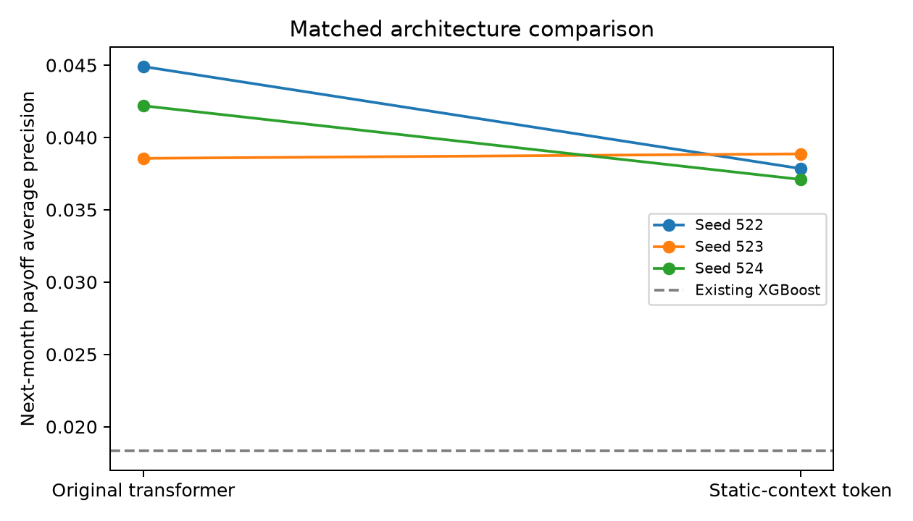

# Static-conditioned attention: paired experiment

The [protocol](PROTOCOL.md) was recorded before fitting this variant.

## Change

The optional `transformer_conditioned` model prepends a projected origination-profile token to the 12 monthly tokens. Both variants retain the direct static-feature classifier connection. Data preparation, features, splits, optimization, and validation checkpoint selection are matched. The new projection adds parameters; this is an architecture comparison, not a parameter-matched capacity experiment.

## Data and controls

2016–2025 sample cohorts; training targets through 2022, validation in 2023, test after 2023. Each run uses the same 200,000 sampled training windows, 100,000 validation windows, and all 1,009,313 test windows. Ordered loan/month/label fingerprints and saved preprocessing match across all runs. Both models use 12-month context, two layers, four heads, hidden size 64, and up to 15 epochs with patience three. Checkpoints minimize multiclass validation log loss. Only the model seed varies across paired runs.

The unconditioned seed-522 run reproduces the original future-period probabilities exactly. Old checkpoints remain loadable with conditioning disabled by default.

## Results by seed

| Seed | Model | Payoff AP | Payoffs in top 1% | Precision at 1% | Payoff Brier | Macro-F1 | Log loss | Selected epoch |
|---|---|---:|---:|---:|---:|---:|---:|---:|
| 522 | transformer | 0.04490 | 605 | 5.99% | 0.006893 | 0.3219 | 0.09550 | 2 |
| 522 | transformer_conditioned | 0.03785 | 535 | 5.30% | 0.006821 | 0.3150 | 0.09512 | 2 |
| 523 | transformer | 0.03856 | 523 | 5.18% | 0.007044 | 0.3233 | 0.09354 | 5 |
| 523 | transformer_conditioned | 0.03886 | 568 | 5.63% | 0.006797 | 0.3286 | 0.09227 | 11 |
| 524 | transformer | 0.04219 | 541 | 5.36% | 0.006887 | 0.3323 | 0.09160 | 7 |
| 524 | transformer_conditioned | 0.03710 | 508 | 5.03% | 0.007091 | 0.2798 | 0.09707 | 3 |

## Paired primary endpoint

| Seed | Conditioned minus original payoff AP |
|---|---:|
| 522 | -0.00706 |
| 523 | +0.00031 |
| 524 | -0.00509 |

Mean paired AP change: **-0.00395**. Conditioning improves payoff AP in **1 of 3 seeds**. Seed standard deviations describe optimization variability; three seeds do not establish a precise population confidence interval.

Existing XGBoost reference (seed 522): payoff AP 0.01832, top-1% payoff count 318, precision 3.15%. This reference has not been retuned as part of this experiment.

## Interpretation

Results vary by seed, so the extra context token has not established a consistent payoff-ranking advantage. Avoid selecting only the favorable seed or changing the endpoint after seeing these results.

The projected token uses existing origination inputs only, so it introduces no future measurements. It does not address the shortage of rare adverse-exit labels or supply future market rates. Better payoff ranking does not by itself imply calibrated probabilities or improved delinquency/default detection.



## Reproduction

```bash
# Repeat for --seed 522, 523, and 524, using a fresh output directory each time.
MPLCONFIGDIR=/tmp/mortgage-matplotlib .venv/bin/python -m mortgage.cli run \
  --years 2016 2017 2018 2019 2020 2021 2022 2023 2024 2025 \
  --train-end 2022-12 --validation-end 2023-12 \
  --train-limit 200000 --validation-limit 100000 --epochs 15 --seed 522 \
  --models transformer transformer_conditioned --output runs/static-context-522-new
```

The summarizer reads the three original `runs/static-context-SEED` directories:

```bash
MPLCONFIGDIR=/tmp/mortgage-matplotlib .venv/bin/python analysis/compare_static_context.py
```

Full model checkpoints, probabilities, confusion matrices, learning curves, run configurations, and source fingerprints remain under the local ignored run directories.

## Separate GPU repeat

A seed-522 pair also ran on NVIDIA GeForce RTX 5070 using PyTorch 2.15.0+cu132 / CUDA 13.2. All population fingerprints and preprocessing match the CPU comparison. This repeat is not pooled with the primary CPU results.

| Model | GPU payoff AP | Payoffs in top 1% | Median GPU epoch (s) | Median CPU epoch (s) |
|---|---:|---:|---:|---:|
| transformer | 0.04392 | 604 | 3.8 | 32.6 |
| transformer_conditioned | 0.03840 | 522 | 3.4 | 35.2 |

GPU run wall time: 55.5 seconds; peak allocated CUDA tensor memory: 0.083 GiB. Epochs include validation. CPU fits overlapped other CPU runs, so timings are descriptive, not an isolated benchmark. CPU/GPU floating-point paths can select different checkpoints.

See [GPU verification details](GPU.md) and the [GPU setup instructions](../../README.md#gpu-training).
