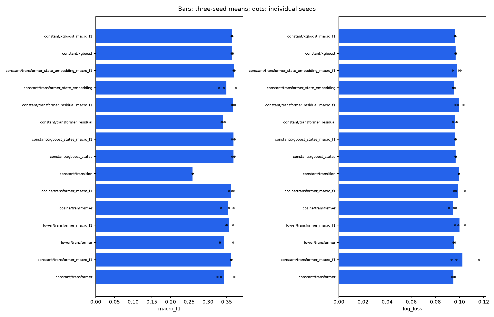

# Transformer improvement experiments

See the [interpretation](INTERPRETATION.md) and [predeclared protocol](PROTOCOL.md).

The validation-only training-recipe selection chose **constant**. Architecture changes use that same recipe. All arms share one million training targets, 100,000 checkpoint-selection validation targets, 1,009,313 test targets, identical preprocessing, and three paired seeds. Every transformer fit uses 6,000 updates and 3,072,000 example exposures. All fitted models use CUDA on the RTX 5070.

Names ending in `_macro_f1` use validation macro-F1 checkpoint selection; other transformer/XGBoost names use validation log loss. Both are reported and share a fit. The transition baseline is estimated from training data only; persistence is unchanged.

## Overall means over three seeds

| Stage | Recipe | Model / checkpoint | Validation log loss | Test macro-F1 ↑ | Test log loss ↓ | Test accuracy |
|---|---|---|---:|---:|---:|---:|
| optimization | constant | transformer | 0.07005 | 0.3437 | 0.09490 | 0.97993 |
| optimization | constant | transformer_macro_f1 | 0.07402 | 0.3625 | 0.10235 | 0.98006 |
| optimization | lower | transformer | 0.07032 | 0.3438 | 0.09543 | 0.97983 |
| optimization | lower | transformer_macro_f1 | 0.07203 | 0.3556 | 0.09988 | 0.98014 |
| optimization | cosine | transformer | 0.07062 | 0.3534 | 0.09446 | 0.98038 |
| optimization | cosine | transformer_macro_f1 | 0.07134 | 0.3627 | 0.09880 | 0.98030 |
| architecture | constant | transition | 0.08290 | 0.2587 | 0.09938 | 0.97864 |
| architecture | constant | xgboost_states | 0.07277 | 0.3686 | 0.09676 | 0.98043 |
| architecture | constant | xgboost_states_macro_f1 | 0.07284 | 0.3686 | 0.09654 | 0.98045 |
| architecture | constant | transformer_residual | 0.07223 | 0.3402 | 0.09645 | 0.98012 |
| architecture | constant | transformer_residual_macro_f1 | 0.07322 | 0.3678 | 0.09955 | 0.98031 |
| architecture | constant | transformer_state_embedding | 0.07007 | 0.3493 | 0.09519 | 0.98001 |
| architecture | constant | transformer_state_embedding_macro_f1 | 0.07213 | 0.3700 | 0.09812 | 0.98029 |
| reference | constant | persistence | — | 0.3678 | — | 0.97917 |
| reference | constant | xgboost | 0.07293 | 0.3651 | 0.09678 | 0.98046 |
| reference | constant | xgboost_macro_f1 | 0.07319 | 0.3642 | 0.09629 | 0.98050 |

## Paired changes against the appropriate ordinary transformer

Optimization arms compare with constant 0.001. Architecture arms compare with the selected recipe's ordinary transformer. Positive macro-F1 changes and negative log-loss changes are improvements.

| Stage | Recipe | Variant | Mean F1 change | F1 improves in seeds | Mean loss change | Loss improves in seeds |
|---|---|---|---:|---:|---:|---:|
| optimization | constant | transformer | +0.00000 | 0/3 | +0.00000 | 0/3 |
| optimization | constant | transformer_macro_f1 | +0.00000 | 0/3 | +0.00000 | 0/3 |
| optimization | lower | transformer | +0.00006 | 1/3 | +0.00053 | 1/3 |
| optimization | lower | transformer_macro_f1 | -0.00683 | 1/3 | -0.00247 | 2/3 |
| optimization | cosine | transformer | +0.00963 | 2/3 | -0.00043 | 1/3 |
| optimization | cosine | transformer_macro_f1 | +0.00020 | 2/3 | -0.00355 | 2/3 |
| architecture | constant | transformer_residual | -0.00349 | 2/3 | +0.00156 | 1/3 |
| architecture | constant | transformer_residual_macro_f1 | +0.00535 | 3/3 | -0.00279 | 1/3 |
| architecture | constant | transformer_state_embedding | +0.00562 | 3/3 | +0.00030 | 1/3 |
| architecture | constant | transformer_state_embedding_macro_f1 | +0.00752 | 3/3 | -0.00423 | 1/3 |

## Calibration diagnostic

Temperatures are fitted only on 196,496 validation targets excluded from checkpoint selection. Calibration targets may share validation loans/input history with selection targets; all test loans remain separate. Scalar temperature scaling preserves classification, so macro-F1 is unchanged. Bounds are 0.1–10, using probabilities clipped at 1e-15.

| Stage | Recipe | Model | Mean temperature | Log loss before | Log loss after | Brier before | Brier after |
|---|---|---|---:|---:|---:|---:|---:|
| optimization | constant | transformer | 0.916 | 0.09490 | 0.09072 | 0.03487 | 0.03420 |
| optimization | constant | transformer_macro_f1 | 0.878 | 0.10235 | 0.09423 | 0.03679 | 0.03493 |
| optimization | lower | transformer | 0.902 | 0.09543 | 0.09070 | 0.03501 | 0.03429 |
| optimization | lower | transformer_macro_f1 | 0.883 | 0.09988 | 0.09293 | 0.03592 | 0.03447 |
| optimization | cosine | transformer | 0.898 | 0.09446 | 0.08945 | 0.03455 | 0.03376 |
| optimization | cosine | transformer_macro_f1 | 0.881 | 0.09880 | 0.09197 | 0.03562 | 0.03428 |
| architecture | constant | xgboost_states | 0.863 | 0.09676 | 0.08955 | 0.03450 | 0.03354 |
| architecture | constant | xgboost_states_macro_f1 | 0.861 | 0.09654 | 0.08932 | 0.03442 | 0.03349 |
| architecture | constant | transformer_residual | 0.885 | 0.09645 | 0.09067 | 0.03497 | 0.03410 |
| architecture | constant | transformer_residual_macro_f1 | 0.863 | 0.09955 | 0.09186 | 0.03554 | 0.03413 |
| architecture | constant | transformer_state_embedding | 0.914 | 0.09519 | 0.09095 | 0.03492 | 0.03420 |
| architecture | constant | transformer_state_embedding_macro_f1 | 0.887 | 0.09812 | 0.09190 | 0.03532 | 0.03422 |
| reference | constant | xgboost | 0.862 | 0.09678 | 0.08950 | 0.03449 | 0.03352 |
| reference | constant | xgboost_macro_f1 | 0.858 | 0.09629 | 0.08893 | 0.03429 | 0.03341 |

## Per-class and year-level results

[Per-class precision, recall, F1, and support](per_class.csv), [year scores](by_year.csv), [transition accuracy](transitions.csv), [every seed](metrics.csv), [paired differences](paired_differences.csv), [checkpoints](checkpoints.csv), and [resources](resources.csv) are saved alongside this report. Calibration JSON files contain before/after class scores and year breakdowns for every arm. Training curves remain with their fitted checkpoints in `runs/`.

## Limits

Test data have already been inspected, so this is exploratory. Three seeds measure optimization variability, not population confidence intervals. Rare exits remain poorly supported. Prepending a static token, adding longer history, and scaling data were earlier separate experiments; no test-selected combinations are fitted here. The residual method includes zero initialization of its final correction layer, so a gain would not isolate the prior from that initialization. Runtime includes preprocessing and evaluation; checkpoint variants share a fit. Calibration does not demonstrate robustness to future distribution shifts.



## Reproduce

```bash
MPLCONFIGDIR=/tmp/mortgage-matplotlib .venv-gpu/bin/python analysis/run_transformer_improvements.py
MPLCONFIGDIR=/tmp/mortgage-matplotlib .venv-gpu/bin/python -m analysis.calibrate_transformer_improvements
MPLCONFIGDIR=/tmp/mortgage-matplotlib .venv-gpu/bin/python -m analysis.compare_transformer_improvements
```
